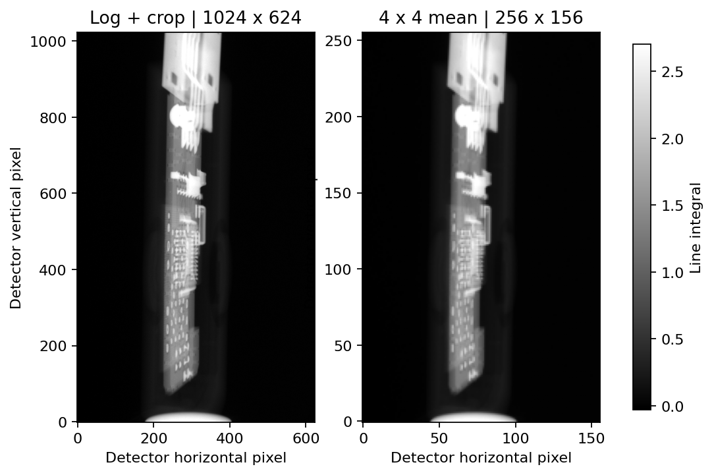
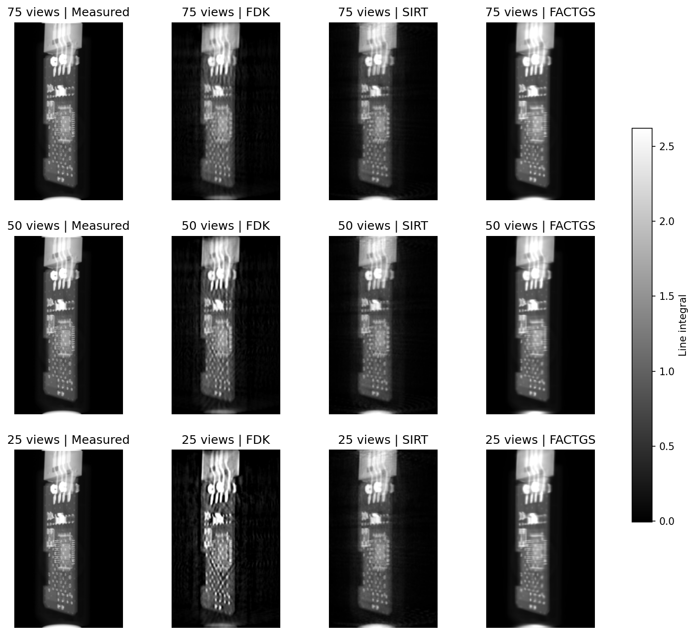
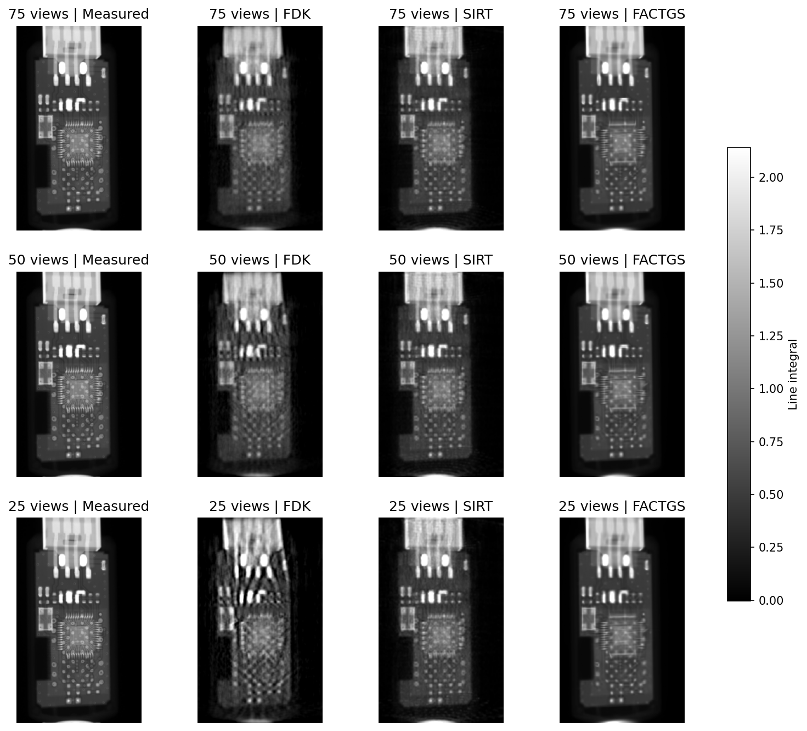
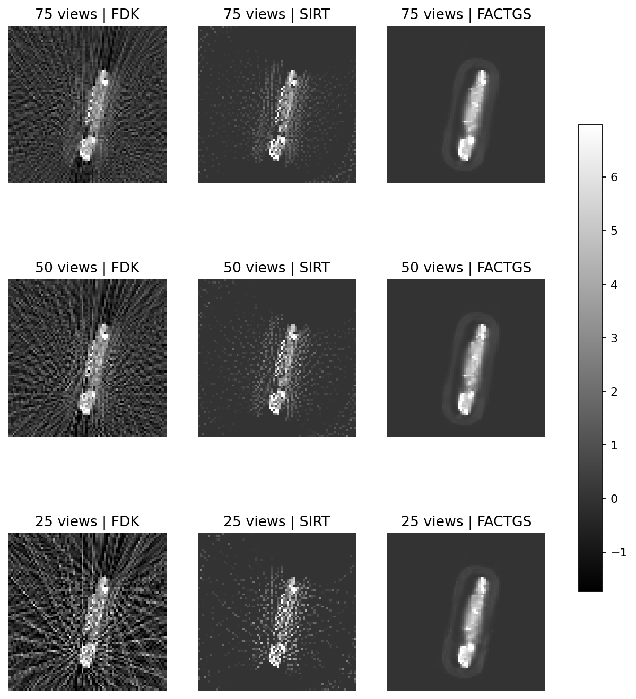
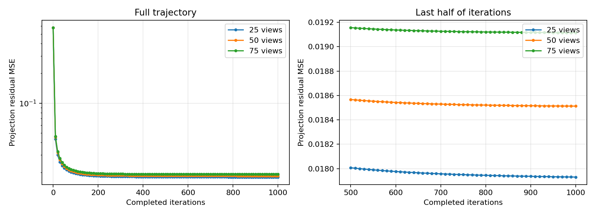
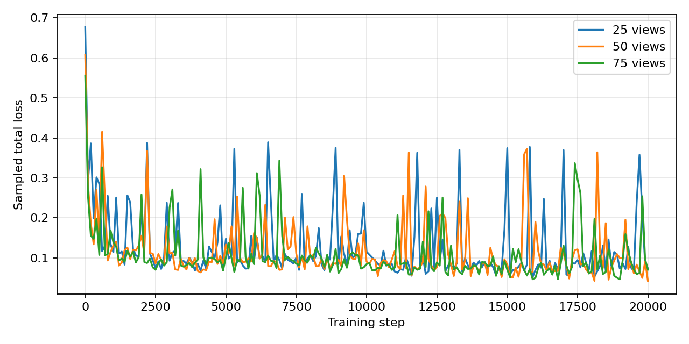

# Experiment 1: 360° Sparse-View 3D Reconstruction with FDK, SIRT, and FaCT-GS


## Data Preprocessing and Input Configuration

Raw file: `dataset/usb/gruppe 4/gruppe 4_2014-03-20_1404_12/tomo-A/gruppe 4_tomo-A.txrm`.

1. CIL `ZEISSDataReader` reads 801 projections of size 1024×1024, normalizes them using the reference image, and applies the integer pixel shifts recorded in the file.
2. `TransmissionAbsorptionConverter` applies the negative logarithm to transmission values, with `white_level=1` and a lower bound of `1e-6`. No pixels reached this lower bound.
3. Cropping 200 pixels from each horizontal side produces float32 attenuation line integrals of shape `801×1024×624`, saved in `dataset/usb_cil/projections.npy`. All values are finite, with a range of [-0.438559, 3.227424]. No denoising is applied; negative attenuation values are retained. Flat-field correction and the logarithm are not applied again.
4. The attenuation line integrals are downsampled by 4×4 block averaging, giving reconstruction inputs of `256×156` pixels per projection. This is spatial downsampling after the logarithm, rather than binning raw photon counts.

| Input | Configuration |
| --- | --- |
| Scan geometry | 360° cone beam, initial angle offset 0° |
| Reconstruction views (training set) | 75 / 50 / 25, selected uniformly by angle, excluding the near-duplicate endpoint view |
| Reconstruction input arrays | `75×256×156`, `50×256×156`, and `25×256×156`, respectively |
| Test set | 20 fixed views selected uniformly over the remaining indices outside the union of the three training sets; the duplicate final angle is excluded |
| 3D volume | ZYX `128×78×78`, with XYZ voxel spacing approximately `(0.015625, 0.015625, 0.015625)` |
| Coordinates and density | The longest geometric dimension is normalized to 2; projection values are unchanged. Density is expressed in inverse normalized length units |
| FDK | CIL/TIGRE cone-beam filtered backprojection |
| SIRT | CIL/TIGRE, zero initialization, nonnegativity constraint, 1000 iterations |
| FaCT-GS | The same view splits and volume grid, trained for 20000 steps |

Original test-view indices: `[1, 41, 84, 126, 168, 210, 252, 294, 337, 379, 420, 462, 505, 547, 589, 631, 673, 714, 758, 799]`. The exact training/test indices are stored in [export_manifest.json](assets/export_manifest.json).

The figure below shows the projection at original index 0: the left panel shows the data after the negative logarithm and cropping, and the right panel shows the reconstruction input after block averaging. Both panels share the same grayscale window. The display window does not change the input data.




## Runtime and Projection Images

Times are taken from the reconstruction `manifest.json` files and represent single runs. Timing includes the FDK call, or SIRT initialization, iterations, and writing the objective-function history. It excludes data loading, volume saving, and subsequent forward projection. These runs used GPU 1, the `fact-gs` environment, and CIL `26.0.1.dev11+gb39f95799`. FDK and SIRT were rerun in separate processes for each of the 25-, 50-, and 75-view settings. The table, slice figures, and test-projection figures use these results.

| Training views | Method | Reconstruction time (s) |
| --- | --- | ---: |
| 25 | FDK | 0.2734 |
| 25 | SIRT | 29.4936 |
| 50 | FDK | 0.2835 |
| 50 | SIRT | 43.8585 |
| 75 | FDK | 0.3135 |
| 75 | SIRT | 50.9737 |

Training/test projection PSNR and SSIM were computed consistently using a separate script; results appear under “Projection PSNR / SSIM” below. FDK and SIRT use CIL/TIGRE forward projection of the reconstructed volumes, while FaCT-GS uses its Gaussian renderer. All three methods save every measured and rendered image, together with float32 arrays without display clipping or normalization.

Individual projections are stored under `projections/` in each result directory. `train_measured/` and `test_measured/` contain measured projections; `train_fdk/`, `test_fdk/`, `train_sirt/`, `test_sirt/`, `train_factgs/`, and `test_factgs/` contain the corresponding rendered projections. Each view has matching `<original-view-index>.png` and `<original-view-index>.npy` files. Complete stacks, source indices, and angles are also saved as `projections.npy`, `source_indices.npy`, and `angles.npy`. PNG files are for display only; metrics use the original float32 NPY files.

### Training-View Projection Comparison

Original index 96 (approximately −136.80°) is included in all three training sets. Columns show the measured projection, FDK, SIRT, and FaCT-GS; rows correspond to 75, 50, and 25 training views. The measured input was verified to be identical across all nine runs. All images share a grayscale window defined by the 1st and 99th percentiles of this measured projection. This affects display only and does not modify the original floating-point data. FDK and SIRT use volume forward projections; FaCT-GS uses Gaussian-rendered projections.



### Test-View Projection Comparison

The selected held-out test view is shared by all three settings: original index 252 (approximately -66.60°), which was not used in any reconstruction. Columns show the measured projection, FDK, SIRT, and FaCT-GS; rows correspond to 75, 50, and 25 training views. All images share the grayscale window [-0.002648, 2.140586], defined by the 1st and 99th percentiles of the measured projection, for display only. FDK and SIRT use forward projections of the reconstructed volumes; FaCT-GS uses Gaussian-rendered projections. SIRT uses 1000 iterations and FaCT-GS uses 20000 training steps.




## Central-Slice Structure Visualization

The same central axial slice, `volume[64, :, :]`, is selected from each volume (zero-based Z index). Columns show FDK, SIRT, and FaCT-GS; rows correspond to 75, 50, and 25 training views. All nine images share a grayscale window defined by the 1st and 99.5th percentiles of the pooled slice values. This affects display only; the saved volumes are not clipped. SIRT uses 1000 iterations and FaCT-GS uses 20000 training steps.



Complete reconstructed volumes and individual projections:

- 25 views: FDK (`cil/usb_360deg_25views_fdk/`, not bundled) / SIRT (`cil/usb_360deg_25views_sirt_1000/`, not bundled) / FaCT-GS (`fact-gs/usb_360deg_25views_20000steps/`, not bundled).
- 50 views: FDK (`cil/usb_360deg_50views_fdk/`, not bundled) / SIRT (`cil/usb_360deg_50views_sirt_1000/`, not bundled) / FaCT-GS (`fact-gs/usb_360deg_50views_20000steps/`, not bundled).
- 75 views: FDK (`cil/usb_360deg_75views_fdk/`, not bundled) / SIRT (`cil/usb_360deg_75views_sirt_1000/`, not bundled) / FaCT-GS (`fact-gs/usb_360deg_75views_20000steps/`, not bundled).


## Projection PSNR / SSIM

The separate script `script/usb_dataset_gaussian/evaluate_projections.py` reads the saved float32 NPY files. Checks cover array dimensions, view indices, angle alignment, and disjoint training/test sets. SIRT uses 1000 iterations and FaCT-GS uses 20000 steps. All three settings use the same 20 test projections.

All nine runs share `data_range = 3.142874300`, defined as the maximum minus the minimum across all measured training/test reference projections in this evaluation (range [-0.046908915, 3.095965385]). No per-image normalization or clipping is applied to measured or rendered data, and PNG display windows are not used. PSNR and SSIM are computed per projection and then averaged arithmetically over views. PSNR is `10 log10(data_range² / MSE)`; SSIM uses a 7×7 uniform window and sample covariance.

| Training views | Method | Training PSNR (dB) | Training SSIM | Test PSNR (dB) | Test SSIM |
| --- | --- | ---: | ---: | ---: | ---: |
| 25 | FDK | 21.7512 | 0.4722 | 22.2558 | 0.4308 |
| 25 | SIRT | 28.7238 | 0.7046 | 26.9690 | 0.6383 |
| 25 | FaCT-GS | 28.0230 | 0.9474 | 27.3968 | 0.9361 |
| 50 | FDK | 24.7226 | 0.5724 | 24.0361 | 0.5279 |
| 50 | SIRT | 28.3567 | 0.7157 | 27.5251 | 0.6755 |
| 50 | FaCT-GS | 28.0360 | 0.9512 | 27.4545 | 0.9396 |
| 75 | FDK | 25.2809 | 0.6038 | 24.5890 | 0.5714 |
| 75 | SIRT | 28.2315 | 0.7200 | 27.6698 | 0.6887 |
| 75 | FaCT-GS | 28.3846 | 0.9534 | 27.7180 | 0.9428 |

The references are noisy measured projections, so these metrics quantify projection consistency. Training results measure fitting to the inputs; test results measure performance at views excluded from reconstruction. These are not ground-truth metrics for 3D slices or volumes. This dataset has no 3D ground truth, so 3D PSNR/SSIM are not computed. FDK and SIRT use volume forward projection, while FaCT-GS uses the Gaussian renderer.

[Per-view metrics and evaluation configuration (JSON)](assets/projection_metrics.json) · [Summary CSV](assets/projection_metrics.csv)

Original project command (`fact-gs` environment; the corresponding projection arrays are not bundled here):

```bash
python script/usb_dataset_gaussian/evaluate_projections.py --views 25 50 75 --methods fdk sirt factgs
```


## Independent Runs and Output Validation

All nine runs completed independently. Each saves the full 3D volume, central slices in three directions, and every measured and rendered training/test projection. For each method, the 25-, 50-, and 75-view settings save 90, 140, and 190 PNG/NPY pairs, respectively, for a total of 1260 pairs across nine runs. Validation confirmed finite volume and projection values, agreement between individual NPY files and stacked arrays, correct view pairing, and disjoint training/test indices. FDK logs are `output/log/usb_cil_<view-count>views_fdk.log`; SIRT logs are `output/log/usb_cil_<view-count>views_sirt_1000.log`; FaCT-GS logs are `output/log/usb_factgs_<view-count>views_20000steps.log`.


## SIRT Loss Curves (1000 Iterations)

All SIRT runs use zero initialization, a nonnegativity constraint, and 1000 iterations. Every 10 iterations, `0.5 × sum((Ax-b)²)` is recomputed from the current volume. The figure converts this to residual MSE using the number of projection pixels, so the sum is not scaled by the number of views. This is the optimization loss, not a test-set metric. CIL's internally weighted cached residual is not used for these curves.



The heuristic criterion for “approximately stable loss” is an absolute relative loss change below 0.1% over each of five consecutive ten-step intervals. The 25-view run first meets this criterion at step 320; the 50- and 75-view runs first meet it at step 310. All three still satisfy it at step 1000. This criterion does not establish optimal reconstruction quality; all experiments retain the results at iteration 1000.

Each result includes `sirt_loss.json`, `sirt_loss.png`, the complete volume, and individual projections. Runtime includes periodic loss evaluation but excludes plotting and subsequent projection export. The default iteration count is 1000.


## FaCT-GS: 3D Reconstruction with the Same Data Splits

The dataset interface is `script/usb_dataset_gaussian/usb_dataset.py`. The converter reuses the fixed training/test indices from this experiment: 25, 50, or 75 training views and the same 20 test views. Projection block averaging, normalized coordinates, and the volume grid match CIL. Measured projection values were verified to be exactly equal for every view. No 3D ground truth is available.

Training inputs are flipped vertically to follow the FaCT-GS camera convention, then restored to CIL's vertical direction during export. The current FaCT-GS voxelization interface actually outputs XYZ arrays; exported NPY volumes are transposed to ZYX. Axis order and position were verified using an off-center Gaussian phantom.

### Training Settings and Runtime

Each setting is trained for 20000 steps with random seed 0 and 10000 initial Gaussians. Gradient initialization uses an FDK reconstruction of the training projections, with an initialization density threshold of 0.01. The FaCT-GS objective is retained: `L1 + 0.3 × (1-SSIM) + 0.05 × TV`, with TV computed on a random 32³ subvolume. Gaussian densification is enabled. Learning rates for position, density, scale, and rotation decay from `0.0002/0.01/0.005/0.001` to `0.00002/0.001/0.0005/0.0001`, respectively. Full settings are saved in each run's `config.yaml`.

The 25-, 50-, and 75-view runs executed independently in parallel on GPUs 1, 2, and 3, respectively. Training time comes from the official training loop and excludes initialization, final saving, and callback export; total elapsed time includes these steps. Its timing scope therefore differs from that of CIL reconstruction. A fixed training budget does not establish convergence.

| Training views | Training loop time (s) | Total time from initialization through export (s) | Final Gaussian count |
| --- | ---: | ---: | ---: |
| 25 | 100.024 | 106.453 | 15049 |
| 50 | 95.116 | 101.972 | 14795 |
| 75 | 105.984 | 113.715 | 15299 |

### Saved Outputs

Each run saves `factgs_volume.npy` (float32, ZYX `128×78×78`, without clipping), the Gaussian model `point_cloud/step_20000/point_cloud.pickle`, `training_loss.json/png`, `manifest.json`, `config.yaml`, and three-direction slice images in `slices.png`.

Under `projections/`, `train_measured/`, `test_measured/`, `train_factgs/`, and `test_factgs/` store measured and rendered projections. Every view has a matching PNG and original float32 NPY, alongside complete arrays, original indices, and CIL angles in radians. PNG files use the same grayscale window as CIL. The three runs save 420 PNG/NPY pairs in total, and output completeness has been verified. Metrics use floating-point NPY files, not PNG files. FaCT-GS projections are generated by the Gaussian renderer.

Rendered projections have also been copied to `assets/projections/<view-count>views/{train,test}_factgs/` so that the independent `evaluate_projections.py` script can read them alongside FDK and SIRT. All three methods have been evaluated using the same PSNR/SSIM protocol.

### Training Loss

Training loss is recorded every 100 steps using the currently sampled view and random TV subvolume. The curve can therefore fluctuate and is not the mean error over the full training set. Step 0 is the first training step in the official loop, not a separate evaluation of the initial model. This loss has a different definition from SIRT's residual MSE, so their numerical values are not directly comparable.



The FaCT-GS repository baseline commit is `983bbf6`. The USB adaptation scripts are outside that repository; no source files within the FaCT-GS repository were modified for this experiment.


## Examining the Difference Between Mean PSNR and SSIM

For the 20 test projections in the 75-view setting, the table reports the arithmetic mean of per-image PSNR: 27.6698 dB for SIRT and 27.7180 dB for FaCT-GS. However, MSE pooled over all test pixels is 0.022896 and 0.051333, respectively. Computing PSNR from pooled MSE instead gives 26.3489 dB and 22.8426 dB. These aggregation methods differ because taking a logarithm and averaging are not interchangeable.

Median per-image test MSE is 0.009529 for FaCT-GS and 0.012850 for SIRT, but FaCT-GS has a few high-error views. Indices 420, 41, and 1 contribute approximately 75.19% of its total squared error; the same three views contribute approximately 49.12% for SIRT. At index 420, PSNR is 13.687 dB for FaCT-GS and 18.979 dB for SIRT. Similar mean PSNR therefore does not imply similar total pixel error or similar performance at every view.

For the same data, the mean local luminance component of SSIM is 0.7496 for SIRT and 0.9754 for FaCT-GS; the mean combined local contrast/structure component is 0.9271 and 0.9640, respectively. Final SSIM averages the window-wise products of these components, rather than multiplying their separate means. FaCT-GS achieves better local matching while retaining large numerical errors in a few projections. Its training loss includes DSSIM, but the metric difference cannot be attributed entirely to this term without an ablation experiment.
