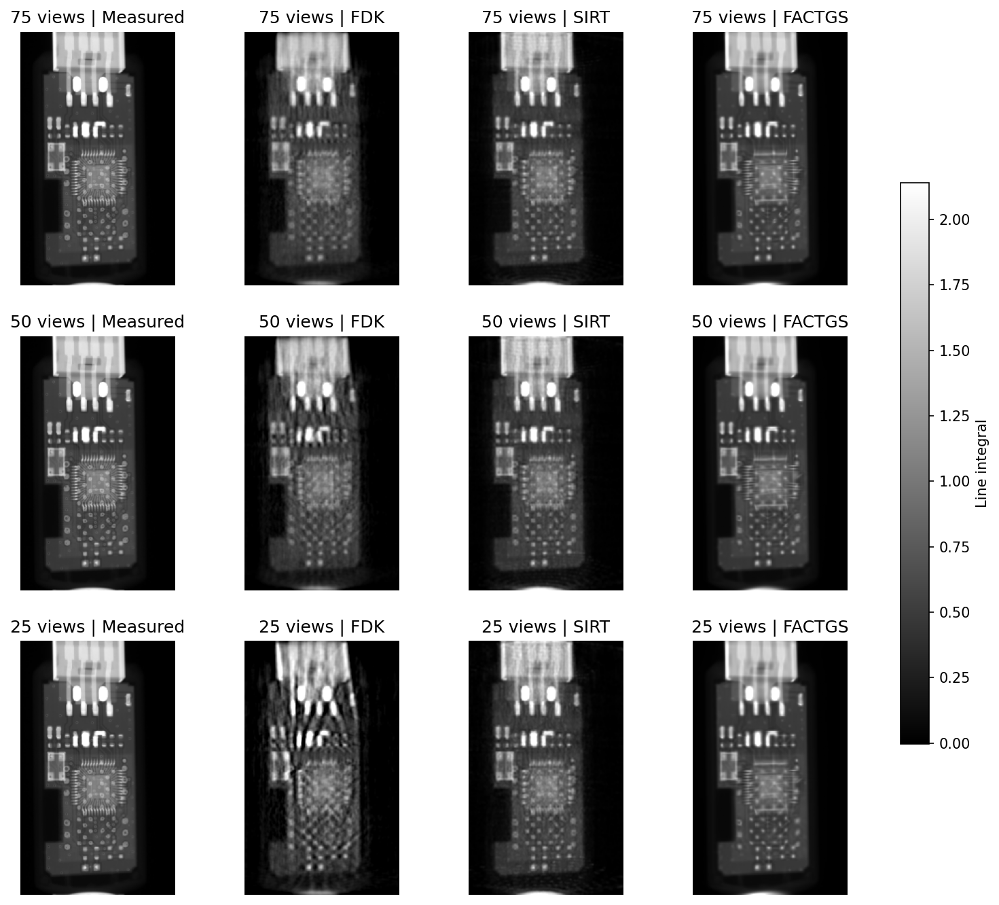

<!--
SPDX-FileCopyrightText: 2026 Yue Jiaming
SPDX-License-Identifier: MIT
-->

# USB Sparse-View CT

Compare **FDK, SIRT and FaCT-GS** for 3D cone-beam CT reconstruction of a USB scan using **25, 50 and 75 training views**. The methods share preprocessing, reconstruction geometry and 20 held-out test views for projection PSNR/SSIM evaluation.

## Start here

Open **[USB_Sparse_View.ipynb](USB_Sparse_View.ipynb)**. Section 1 contains installation commands; Section 2 downloads and preprocesses the USB dataset and configures the GPU and reconstruction methods. Run the notebook from this repository directory with the `usb-showcase` kernel.

## Environment

- Linux with an NVIDIA GPU.
- Python 3.10, PyTorch 2.4.1 (`cu118`), CUDA Toolkit 11.8 and GCC/G++ 11.
- Python dependencies are listed in [requirements.txt](requirements.txt). Follow notebook Section 1 to install the CUDA-enabled PyTorch build, pinned FaCT-GS source, USB integration patch and compiled extensions.
- The USB scan is downloaded separately through CIL; installation and data download require internet access.

For an existing CIL/TIGRE environment, FDK/SIRT can run without FaCT-GS. Disable `RUN_FACTGS` in Section 2.1; the Section 5 batch comparison inherits the method switches. Batch reconstruction is enabled by default and reruns all three view counts; set `RUN_ALL_VIEWS = False` to skip it.

## Example result

Held-out projection comparison at original view index 252. Rows use 75, 50 and 25 training views; columns show the measured projection, FDK, SIRT and FaCT-GS.

This figure comes from the **historical experiments** documented in [EXPERIMENT_RECORD.md](EXPERIMENT_RECORD.md). Their environment and results may differ from the current notebook; use outputs from your own complete notebook run to assess the current configuration.

Original contributions are [MIT-licensed](LICENSE.txt). Third-party code and data retain their own terms; see the notebook's licensing and references section.
